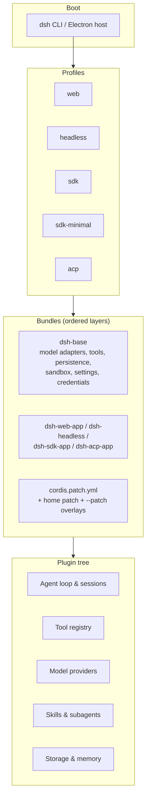

English | [中文](README.zh.md)

**Build. Orchestrate. Automate.**

VEXER Agent is an open-source AI agent orchestration platform for coordinating
intelligent agents, extensible skills, persistent memory, workflow automation,
and AI model provider integrations.

It runs as a plugin tree: every capability — the model adapter, the tool
registry, the session log, the agent loop itself — is a plugin you can
replace, disable, or extend from configuration. There is no privileged core
to patch.

> **Status:** experimental developer-preview software. It has not undergone a
> security audit and is not production-ready. Read [SAFETY.md](SAFETY.md)
> before running it.

---

## Contents

- [Features](#features)
- [Architecture](#architecture)
- [Requirements](#requirements)
- [Installation](#installation)
- [Configuration](#configuration)
- [Model providers](#model-providers)
- [Quick start](#quick-start)
- [Interfaces](#interfaces)
- [Development](#development)
- [Testing](#testing)
- [Troubleshooting](#troubleshooting)
- [Security](#security)
- [Contributing](#contributing)
- [License and attribution](#license-and-attribution)
- [Roadmap](#roadmap)

<a id="features"></a>

## Features

Verified against the implementation in this repository:


| Capability | Where it lives |
|---|---|
| **Agent orchestration** — agent loop, sessions, goals, planning, and multi-turn execution | `packages/core`, `packages/goal`, `packages/plan` |
| **Plugin architecture** — Cordis-based plugins contribute services, typed events, and reversible effects | `vendor/cordis`, `docs/cordis-primer.md` |
| **Agent skills** — loadable skill definitions and a skill tool | `packages/skill` |
| **Persistent sessions and tasks** — append-only session log, todo tracking, background jobs | `packages/session`, `packages/todo`, `packages/jobs` |
| **Memory and knowledge** — Redis/ClickHouse-backed memory plugins and knowledge extensions | `packages/memory`, `packages/extensions` |
| **40+ model providers** — DeepSeek, Anthropic, OpenAI, Google, Groq, OpenRouter, Mistral, xAI, and more | `packages/llm`, `provider-data.generated.ts` |
| **Workflow automation** — workflow execution with PTC runtime support | `packages/workflow`, `packages/ptc-runtime` |
| **Web interface** — browser application with sessions, terminal, and plugin manager | `apps/web` |
| **Desktop application** — Electron app packaging the same runtime | `apps/desktop` |
| **Command-line interface** — the `dsh` launcher and profile system | `apps/cli` |
| **SDKs** — TypeScript SDK and Python SDK over JSON-RPC | `packages/sdk`, `python/sdk` |
| **Subagents** — delegated agents, including Claude Code and Codex adapters | `packages/subagent` |
| **Tooling** — shell, filesystem, LSP, web fetch/search, browser and computer use | `packages/shell`, `packages/fs`, `packages/lsp`, `packages/web`, `packages/browser-use` |
| **Sandboxing and approvals** — process confinement and permission policy | `packages/sandbox`, `packages/guard` |

Experimental capabilities are marked as such in
[`packages/experimental`](packages/experimental/README.md) and carry no
product-support commitment.

<a id="architecture"></a>

## Architecture

Everything mounts through **Cordis**, a plugin framework. A running instance
is a plugin tree composed at boot from ordered layers:



Key ideas:

- **No privileged core.** Extend by mounting a plugin beside the others;
  registrations are effects that unwind when the plugin unloads.
- **Profiles** are named compositions; **bundles** are distribution units for
  Cordis config rows and the code they mount, so higher layers stay patchable.
- **Patches** target a row by id — replace its whole config or insert new rows.

Inspect the tree your machine boots with:

```bash
pnpm dsh --profile web --dump-config
```

Read [docs/architecture.md](docs/architecture.md) before changing anything
under `packages/`.

<a id="requirements"></a>

## Requirements

| | |
|---|---|
| **Node.js** | `^22.19.0` or `>=24.0.0` (Node 24 recommended) |
| **pnpm** | `11.28.5` (pinned via `packageManager`) |
| **RAM** | 4 GB minimum for builds |
| **OS** | macOS, Linux, Windows |

Other package managers are not supported — the workspace and lockfile are
pnpm-specific.

<a id="installation"></a>

## Installation

```bash
git clone https://github.com/fuvision-devs/Vexer.git
cd Vexer
pnpm install
pnpm run build:artifacts
```

`pnpm install` installs all workspace packages and runs the `postinstall`
hook that sets up lefthook.

> **Building from a source archive?** `pnpm run build:artifacts` embeds a Git
> commit hash in browser artifacts. In a Git checkout this is read
> automatically. If you have no Git metadata, set it explicitly:
>
> ```bash
> DSH_CLIENT_COMMIT_HASH=0000000 pnpm run build:artifacts
> ```

<a id="configuration"></a>

## Configuration

Copy the environment template and fill in what you need:

```bash
cp .env.example .env
```

`.env` is gitignored. **Never commit real credentials.**

The root `.env` is read by the test runners. At runtime, provider
credentials are resolved from `process.env` and from the credential store
under `$DSH_HOME` (default `~/.dsh`).

Useful variables:

| Variable | Purpose |
|---|---|
| `DEEPSEEK_API_KEY` | Primary provider key used by real-API tests and demos |
| `DEEPSEEK_BASE_URL` | Optional override for a DeepSeek-compatible endpoint |
| `DSH_HOME` | Harness home: profiles, sessions, credentials, plugins |
| `DSH_AGENTS_HOME` | Home for agent-authored instructions and skills |
| `DSH_TELEMETRY_DISABLED` | Set to `1` to disable outbound telemetry |
| `VEXER_PORT` | Container entrypoint listen port (default `7090`) |
| `DSH_CLIENT_COMMIT_HASH` | Explicit commit hash for builds without Git metadata |

<a id="model-providers"></a>

## Model providers

VEXER supports 40+ providers through a generated catalog. The authoritative
provider → environment-variable mapping is:

[`packages/llm/llm-pi-ai/src/provider-data.generated.ts`](packages/llm/llm-pi-ai/src/provider-data.generated.ts)

Regenerate it with `pnpm run gen-provider-data`. **Do not edit it by hand.**

Examples — replace the placeholder with your own key:

```bash
DEEPSEEK_API_KEY=your_deepseek_api_key_here
ANTHROPIC_API_KEY=your_anthropic_api_key_here
OPENAI_API_KEY=your_openai_api_key_here
GROQ_API_KEY=your_groq_api_key_here
OPENROUTER_API_KEY=your_openrouter_api_key_here
```

Additional supported providers include Google Gemini, Mistral, xAI, Together,
Fireworks, Cerebras, Hugging Face, Moonshot, MiniMax, NVIDIA, Qwen, Azure
OpenAI, Amazon Bedrock, GitHub Copilot, and others — see the catalog for the
exact environment names and default base URLs.

**Notes:**

- You only need **one** provider to get started.
- Provider errors surface through the normal session/tool error path; failed
  authentication is reported in the session rather than silently retried.
- Base URLs and model identifiers are configurable per provider.
- **You are responsible for complying with your chosen provider's terms of
  service and usage limits.** No provider credits, free inference, or
  unlimited usage are promised or implied by this project.

<a id="quick-start"></a>

## Quick start

Once installed and configured:

```bash
# Start the web interface (builds first, then serves on :7090)
pnpm run dev:web -- --port 7090 --no-open --poll

# Or skip the rebuild if artifacts are already built
pnpm run start:web
```

Run a single headless task from source (requires a provider key):

```bash
pnpm dsh --profile headless "your task here"
```

The convenience script does the same thing:

```bash
./run.sh          # default port 7090
./run.sh 8080     # custom port
```

<a id="interfaces"></a>

## Interfaces

| Interface | Command | Notes |
|---|---|---|
| **Web** | `pnpm run dev:web -- --port 7090 --no-open --poll` | Rebuilds client bundles on edit |
| **Web (no rebuild)** | `pnpm run start:web` | Serves already-built artifacts |
| **Desktop** | `pnpm run dev:desktop` | Electron app; `start:desktop` skips the build |
| **CLI** | `pnpm dsh --profile <name> "<task>"` | Profiles: `web`, `headless`, `sdk`, `sdk-minimal`, `acp` |
| **TypeScript SDK** | `packages/sdk` | JSON-RPC over stdio |
| **Python SDK** | `python/sdk` | High-level turns API plus a JSON-RPC client |

Supported Node applications launch **only** through named `dsh` profiles.
Package bins, demos, and public SDK argv escapes are rejected by
`verify-application-entrypoints`.

<a id="development"></a>

## Development

```bash
pnpm install              # install workspace dependencies
pnpm run build:artifacts  # build library, runtime, and Web bundles
pnpm run typecheck        # TypeScript project check
pnpm run lint             # oxlint
pnpm run test             # unit tests
pnpm run build            # build:artifacts + build:check
pnpm run hygiene          # publint + workspace/dependency checks
pnpm run clean            # remove build outputs
```

Repository layout:

```
vendor/      Vendored Cordis framework (see vendor/README.md)
packages/    @deepseek-ai/dsh-<pkg> workspaces at packages/<group>/<pkg>/
apps/        cli, web, desktop, desktop-host, plugin-market-generator
python/      Python SDK and runtime
native/      Native addon source
benchmarks/  Performance gates
scripts/     Build scripts, gates, and generators
docs/        Architecture and contributor documentation
website/     VitePress documentation projection
```

Read [CONTRIBUTING.md](CONTRIBUTING.md) and [AGENTS.md](AGENTS.md) before
opening a pull request.

<a id="testing"></a>

## Testing

```bash
pnpm run test              # unit tests
pnpm run test:coverage     # CI coverage gate (per-file 100% on packages/*/*/src)
pnpm run typecheck         # TypeScript
pnpm run lint              # linting
pnpm run test:e2e          # real-API tests; self-skip without DEEPSEEK_API_KEY
pnpm run test:snapshot     # keyless recorded-session replay
pnpm run test:expected     # owner-local process expectations
pnpm run test:docs         # quick documentation checks
pnpm run doc-sync          # documentation gates
```

Tests that call a live provider **self-skip** when no key is present, so a
keyless run is safe and does not fail.

<a id="troubleshooting"></a>

## Troubleshooting

| Symptom | Cause and fix |
|---|---|
| `Cannot find module` or missing workspace links | Run `pnpm install` |
| `Command failed: git rev-parse HEAD` during build | No Git metadata. Set `DSH_CLIENT_COMMIT_HASH=0000000` |
| Wrong Node version | Use Node `^22.19.0` or `>=24.0.0`; check with `node --version` |
| Provider authentication errors | Check the key for your provider in `.env`; see the catalog for the exact variable name |
| Port already in use | Pass a different port: `pnpm run dev:web -- --port 7091 --no-open` |
| Native module build failures (`node-pty`, `sharp`, `koffi`) | Ensure build tools for your OS are installed; on Windows install the VS C++ build workload |
| `tsconfig.base.json is stale` | Run `pnpm run gen-tsconfig-paths` |
| Out-of-memory during build | Close other processes; builds use ~4 GB. Retry with more available memory |

<a id="security"></a>

## Security

Report vulnerabilities **privately** — see [SECURITY.md](SECURITY.md). Do not
open a public issue for an exploitable vulnerability.

Before running VEXER, read [SAFETY.md](SAFETY.md). In short: it can execute
model-generated code and commands, load third-party plugins, and reach the
network, processes, credentials, and files it is granted. Run it with least
privilege, ideally in a container or disposable machine.

<a id="contributing"></a>

## Contributing

Contributions are welcome. See [CONTRIBUTING.md](CONTRIBUTING.md) for setup,
workflow, and testing requirements, and
[CODE_OF_CONDUCT.md](CODE_OF_CONDUCT.md) for community expectations.

Please preserve upstream copyright and license notices in any file you touch,
and do not submit code you do not have the right to contribute under MIT.

<a id="license-and-attribution"></a>

## License and attribution

### This project

VEXER Agent is distributed under the [MIT License](LICENSE).

### Upstream attribution

This project incorporates **DeepSeek Harness**, which is licensed under the
MIT License with the copyright notice preserved in [LICENSE](LICENSE):

```
Copyright (c) 2026 DeepSeek
```

That upstream copyright notice is **not** replaced or removed by this
project's branding. The vendored Cordis framework and its foundation
libraries are source-vendored under `vendor/`; each directory preserves its
upstream MIT `LICENSE` file, with exact upstream commits and local
modifications recorded in [vendor/README.md](vendor/README.md).

Future Vision maintains this distribution and contributes original
components. Future Vision's own contributions are offered under the same MIT
terms, but **Future Vision does not claim ownership of upstream DeepSeek code
or other contributors' work.**

### Third-party dependencies

Complete dependency licensing is recorded in
[THIRD_PARTY_NOTICES.md](THIRD_PARTY_NOTICES.md), including:

- Direct runtime and development npm dependencies
- Vendored source packages
- Bundled Python distributions
- Patched packages and the patch files that record each modification

Notable non-permissive components are called out explicitly there, including
the MPL-2.0 LibreOffice conversion kit and the Claude Code platform payloads.
**Not every dependency has been independently re-verified for this
distribution**; treat `THIRD_PARTY_NOTICES.md` and `pnpm-lock.yaml` as the
authoritative records.

Regenerate and verify with:

```bash
pnpm run gen-third-party-notices
pnpm run verify-third-party-notices
```

### Maintainer

**Future Vision** — GitHub organization
[`fuvision-devs`](https://github.com/fuvision-devs).

<a id="roadmap"></a>

## Roadmap

Completed and available in this repository:

- [x] Core agent orchestration, sessions, and plugin architecture
- [x] Web, desktop, and CLI interfaces
- [x] Multi-provider model integration (40+ providers)
- [x] Skills, subagents, workflow automation, and tooling
- [x] TypeScript and Python SDKs
- [x] Sandboxing, approval policy, and credential handling

Planned — **not yet implemented, no delivery commitment**:

- [ ] Additional provider integrations
- [ ] Further memory and knowledge-management capabilities
- [ ] Hosted and managed deployment options
- [ ] Enterprise support offerings

Nothing above should be read as a promise of delivery dates, provider
sponsorships, credits, or free hosted inference.

---

<p align="center"><strong>Build. Orchestrate. Automate.</strong></p>
