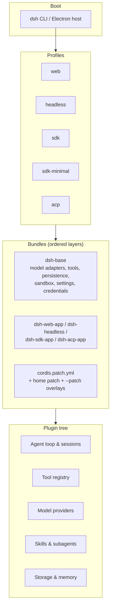

# VEXER Agent

[English](README.md) | 中文

**构建。编排。自动化。**

VEXER Agent 是一个开源 AI 智能体编排平台，用于协调智能体、扩展技能、
持久化记忆、工作流自动化以及多种 AI 模型提供商的集成。

它以插件树的方式运行：每一项能力——模型适配器、工具注册表、会话日志、
乃至智能体循环本身——都是一个插件，你可以从配置中替换、禁用或扩展它。
这里没有需要打补丁的特权内核。

> **状态：** 实验性开发者预览软件。尚未经过安全审计，不具备生产可用性。
> 运行前请阅读 [SAFETY.zh.md](SAFETY.zh.md)。

---

## 目录

- [功能特性](#features)
- [架构](#architecture)
- [环境要求](#requirements)
- [安装](#installation)
- [配置](#configuration)
- [模型提供商](#model-providers)
- [快速开始](#quick-start)
- [界面与接口](#interfaces)
- [开发](#development)
- [测试](#testing)
- [故障排查](#troubleshooting)
- [安全](#security)
- [参与贡献](#contributing)
- [许可证与署名](#license-and-attribution)
- [路线图](#roadmap)

<a id="features"></a>

## 功能特性

以下能力均已对照本仓库实现进行核实：

| 能力 | 所在位置 |
|---|---|
| **智能体编排**——智能体循环、会话、目标、规划与多轮执行 | `packages/core`、`packages/goal`、`packages/plan` |
| **插件架构**——基于 Cordis，插件贡献服务、类型化事件与可逆副作用 | `vendor/cordis`、`docs/cordis-primer.md` |
| **智能体技能**——可加载的技能定义与技能工具 | `packages/skill` |
| **持久化会话与任务**——追加式会话日志、待办跟踪、后台任务 | `packages/session`、`packages/todo`、`packages/jobs` |
| **记忆与知识**——基于 Redis/ClickHouse 的记忆插件与知识扩展 | `packages/memory`、`packages/extensions` |
| **40+ 模型提供商**——DeepSeek、Anthropic、OpenAI、Google、Groq、OpenRouter、Mistral、xAI 等 | `packages/llm`、`provider-data.generated.ts` |
| **工作流自动化**——支持 PTC 运行时的工作流执行 | `packages/workflow`、`packages/ptc-runtime` |
| **Web 界面**——包含会话、终端与插件管理器的浏览器应用 | `apps/web` |
| **桌面应用**——打包同一运行时的 Electron 应用 | `apps/desktop` |
| **命令行接口**——`dsh` 启动器与 profile 体系 | `apps/cli` |
| **SDK**——TypeScript SDK 与基于 JSON-RPC 的 Python SDK | `packages/sdk`、`python/sdk` |
| **子智能体**——受委托的智能体，含 Claude Code 与 Codex 适配器 | `packages/subagent` |
| **工具集**——Shell、文件系统、LSP、网页抓取/搜索、浏览器与计算机操作 | `packages/shell`、`packages/fs`、`packages/lsp`、`packages/web`、`packages/browser-use` |
| **沙箱与审批**——进程隔离与权限策略 | `packages/sandbox`、`packages/guard` |

实验性能力在
[`packages/experimental`](packages/experimental/README.zh.md)
中标注，不提供产品支持承诺。

<a id="architecture"></a>

## 架构

所有能力都通过插件框架 **Cordis** 挂载。运行中的实例是一棵在启动时由
有序分层组合而成的插件树：



核心思想：

- **没有特权内核。** 通过在其他插件旁挂载新插件来扩展；注册即副作用，
  插件卸载时随之撤销。
- **Profile** 是具名的组合；**Bundle** 是 Cordis 配置行及其所挂载代码的
  分发单元，使上层保持可修补。
- **补丁** 以 id 定位某一行——替换其完整配置或插入新行。

查看本机启动的插件树：

```bash
pnpm dsh --profile web --dump-config
```

修改 `packages/` 下的任何内容前，请先阅读
[docs/architecture.zh.md](docs/architecture.zh.md)。

<a id="requirements"></a>

## 环境要求

| | |
|---|---|
| **Node.js** | `^22.19.0` 或 `>=24.0.0`（推荐 Node 24） |
| **pnpm** | `11.28.5`（由 `packageManager` 固定） |
| **内存** | 构建至少 4 GB |
| **操作系统** | macOS、Linux、Windows |

不支持其他包管理器——工作区与锁文件均依赖 pnpm。

<a id="installation"></a>

## 安装

```bash
git clone https://github.com/fuvision-devs/Vexer.git
cd Vexer
pnpm install
pnpm run build:artifacts
```

`pnpm install` 会安装全部工作区包，并运行用于配置 lefthook 的
`postinstall` 钩子。

> **从源码压缩包构建？** `pnpm run build:artifacts` 会在浏览器产物中嵌入
> Git 提交哈希。在 Git 检出中该值会自动读取。若没有 Git 元数据，请显式
> 设置：
>
> ```bash
> DSH_CLIENT_COMMIT_HASH=0000000 pnpm run build:artifacts
> ```

<a id="configuration"></a>

## 配置

复制环境变量模板并按需填写：

```bash
cp .env.example .env
```

`.env` 已被 Git 忽略。**切勿提交真实凭据。**

根目录 `.env` 由测试运行器读取。运行时，提供商凭据从 `process.env` 以及
`$DSH_HOME`（默认 `~/.dsh`）下的凭据存储中解析。

常用变量：

| 变量 | 用途 |
|---|---|
| `DEEPSEEK_API_KEY` | 真实 API 测试与演示所用的主提供商密钥 |
| `DEEPSEEK_BASE_URL` | 可选，覆盖 DeepSeek 兼容端点 |
| `DSH_HOME` | Harness 主目录：profile、会话、凭据、插件 |
| `DSH_AGENTS_HOME` | 智能体自撰指令与技能的主目录 |
| `DSH_TELEMETRY_DISABLED` | 设为 `1` 以禁用外发遥测 |
| `VEXER_PORT` | 容器入口监听端口（默认 `7090`） |
| `DSH_CLIENT_COMMIT_HASH` | 无 Git 元数据的构建所用的显式提交哈希 |

<a id="model-providers"></a>

## 模型提供商

VEXER 通过生成的目录支持 40+ 家提供商。权威的提供商与环境变量映射位于：

[`packages/llm/llm-pi-ai/src/provider-data.generated.ts`](packages/llm/llm-pi-ai/src/provider-data.generated.ts)

使用 `pnpm run gen-provider-data` 重新生成。**请勿手工编辑。**

示例——请将占位符替换为你自己的密钥：

```bash
DEEPSEEK_API_KEY=your_deepseek_api_key_here
ANTHROPIC_API_KEY=your_anthropic_api_key_here
OPENAI_API_KEY=your_openai_api_key_here
GROQ_API_KEY=your_groq_api_key_here
OPENROUTER_API_KEY=your_openrouter_api_key_here
```

其他受支持的提供商包括 Google Gemini、Mistral、xAI、Together、Fireworks、
Cerebras、Hugging Face、Moonshot、MiniMax、NVIDIA、Qwen、Azure OpenAI、
Amazon Bedrock、GitHub Copilot 等——确切的环境变量名与默认基础 URL 请参见
目录。

**说明：**

- 只需配置**其中一家**提供商即可开始使用。
- 提供商错误通过常规的会话/工具错误路径呈现；认证失败会在会话中报告，
  而不会被静默重试。
- 基础 URL 与模型标识符可按提供商配置。
- **你有责任遵守所选提供商的服务条款与使用限制。** 本项目不承诺、也不
  暗示任何提供商积分、免费推理或无限用量。

<a id="quick-start"></a>

## 快速开始

安装并配置完成后：

```bash
# Start the web interface (builds first, then serves on :7090)
pnpm run dev:web -- --port 7090 --no-open --poll

# Or skip the rebuild if artifacts are already built
pnpm run start:web
```

从源码运行单个无头任务（需要提供商密钥）：

```bash
pnpm dsh --profile headless "your task here"
```

便捷脚本执行相同操作：

```bash
./run.sh          # default port 7090
./run.sh 8080     # custom port
```

<a id="interfaces"></a>

## 界面与接口

| 界面 | 命令 | 说明 |
|---|---|---|
| **Web** | `pnpm run dev:web -- --port 7090 --no-open --poll` | 编辑客户端包时自动重建 |
| **Web（不重建）** | `pnpm run start:web` | 提供已构建的产物 |
| **桌面端** | `pnpm run dev:desktop` | Electron 应用；`start:desktop` 跳过构建 |
| **CLI** | `pnpm dsh --profile <name> "<task>"` | profile：`web`、`headless`、`sdk`、`sdk-minimal`、`acp` |
| **TypeScript SDK** | `packages/sdk` | 基于 stdio 的 JSON-RPC |
| **Python SDK** | `python/sdk` | 高层轮次 API 加 JSON-RPC 客户端 |

受支持的 Node 应用**只能**通过具名 `dsh` profile 启动。包 bin、演示脚本
与公开的 SDK argv 逃逸路径会被 `verify-application-entrypoints` 拒绝。

<a id="development"></a>

## 开发

```bash
pnpm install              # install workspace dependencies
pnpm run build:artifacts  # build library, runtime, and Web bundles
pnpm run typecheck        # TypeScript project check
pnpm run lint             # oxlint
pnpm run test             # unit tests
pnpm run build            # build:artifacts + build:check
pnpm run hygiene          # publint + workspace/dependency checks
pnpm run clean            # remove build outputs
```

仓库结构：

```
vendor/      Vendored Cordis framework (see vendor/README.md)
packages/    @deepseek-ai/dsh-<pkg> workspaces at packages/<group>/<pkg>/
apps/        cli, web, desktop, desktop-host, plugin-market-generator
python/      Python SDK and runtime
native/      Native addon source
benchmarks/  Performance gates
scripts/     Build scripts, gates, and generators
docs/        Architecture and contributor documentation
website/     VitePress documentation projection
```

提交 pull request 前请阅读 [CONTRIBUTING.zh.md](CONTRIBUTING.zh.md) 与
[AGENTS.md](AGENTS.md)。

<a id="testing"></a>

## 测试

```bash
pnpm run test              # unit tests
pnpm run test:coverage     # CI coverage gate (per-file 100% on packages/*/*/src)
pnpm run typecheck         # TypeScript
pnpm run lint              # linting
pnpm run test:e2e          # real-API tests; self-skip without DEEPSEEK_API_KEY
pnpm run test:snapshot     # keyless recorded-session replay
pnpm run test:expected     # owner-local process expectations
pnpm run test:docs         # quick documentation checks
pnpm run doc-sync          # documentation gates
```

调用线上提供商的测试在缺少密钥时会**自动跳过**，因此无密钥运行是安全的，
不会导致失败。

<a id="troubleshooting"></a>

## 故障排查

| 现象 | 原因与解决办法 |
|---|---|
| `Cannot find module` 或工作区链接缺失 | 运行 `pnpm install` |
| 构建时报 `Command failed: git rev-parse HEAD` | 缺少 Git 元数据。设置 `DSH_CLIENT_COMMIT_HASH=0000000` |
| Node 版本不符 | 使用 Node `^22.19.0` 或 `>=24.0.0`；用 `node --version` 检查 |
| 提供商认证错误 | 检查 `.env` 中对应提供商的密钥；确切变量名参见目录 |
| 端口被占用 | 指定其他端口：`pnpm run dev:web -- --port 7091 --no-open` |
| 原生模块构建失败（`node-pty`、`sharp`、`koffi`） | 安装对应系统的构建工具；Windows 上需安装 VS C++ 构建工作负载 |
| `tsconfig.base.json is stale` | 运行 `pnpm run gen-tsconfig-paths` |
| 构建时内存不足 | 关闭其他进程；构建约需 4 GB。释放更多内存后重试 |

<a id="security"></a>

## 安全

请**私下**报告漏洞——参见 [SECURITY.md](SECURITY.md)。不要为可利用的漏洞
公开提交 issue。

运行 VEXER 前请阅读 [SAFETY.zh.md](SAFETY.zh.md)。简而言之：它可能执行
模型生成的代码与命令、加载第三方插件，并访问其被授予的网络、进程、凭据与
文件。请以最小权限运行，最好在容器或一次性机器中。

<a id="contributing"></a>

## 参与贡献

欢迎贡献。开发环境搭建、工作流与测试要求见
[CONTRIBUTING.zh.md](CONTRIBUTING.zh.md)，社区期望见
[CODE_OF_CONDUCT.md](CODE_OF_CONDUCT.md)。

请保留所触碰文件中的上游版权与许可声明，不要提交你无权以 MIT 条款贡献的
代码。

<a id="license-and-attribution"></a>

## 许可证与署名

### 本项目

VEXER Agent 以 [MIT License](LICENSE) 分发。

### 上游署名

本项目包含 **DeepSeek Harness**，其以 MIT 许可证授权，版权保留在
[LICENSE](LICENSE) 中：

```
Copyright (c) 2026 DeepSeek
```

本项目的品牌标识**不会**替换或移除该上游版权声明。Cordis 框架及其基础库
以源码形式内嵌于 `vendor/`；每个目录都保留其上游 MIT `LICENSE` 文件，
确切的上游提交与本地修改记录于 [vendor/README.md](vendor/README.md)。

Future Vision 维护本分发版本并贡献原创组件。Future Vision 自身的贡献同样
以 MIT 条款提供，但 **Future Vision 不主张对上游 DeepSeek 代码或其他贡献者
作品的所有权。**

### 第三方依赖

完整的依赖许可记录见
[THIRD_PARTY_NOTICES.md](THIRD_PARTY_NOTICES.md)，涵盖：

- 直接的运行时与开发期 npm 依赖
- 内嵌源码包
- 打包的 Python 发行版
- 被修补的包及其记录每次修改的补丁文件

其中明确指出了若干非宽松许可组件，包括 MPL-2.0 的 LibreOffice 转换套件与
Claude Code 平台载荷。**并非每个依赖都已为本分发版本独立复核**；请以
`THIRD_PARTY_NOTICES.md` 与 `pnpm-lock.yaml` 作为权威记录。

重新生成并校验：

```bash
pnpm run gen-third-party-notices
pnpm run verify-third-party-notices
```

### 维护者

**Future Vision**——GitHub 组织
[`fuvision-devs`](https://github.com/fuvision-devs)。

<a id="roadmap"></a>

## 路线图

本仓库中已完成并可用：

- [x] 核心智能体编排、会话与插件架构
- [x] Web、桌面与 CLI 界面
- [x] 多提供商模型集成（40+ 家）
- [x] 技能、子智能体、工作流自动化与工具集
- [x] TypeScript 与 Python SDK
- [x] 沙箱、审批策略与凭据处理

计划中——**尚未实现，不构成交付承诺**：

- [ ] 更多提供商集成
- [ ] 进一步的记忆与知识管理能力
- [ ] 托管与托管式部署选项
- [ ] 企业级支持服务

以上任何条目都不应被解读为交付日期、提供商赞助、积分或免费托管推理的承诺。

---

<p align="center"><strong>构建。编排。自动化。</strong></p>
